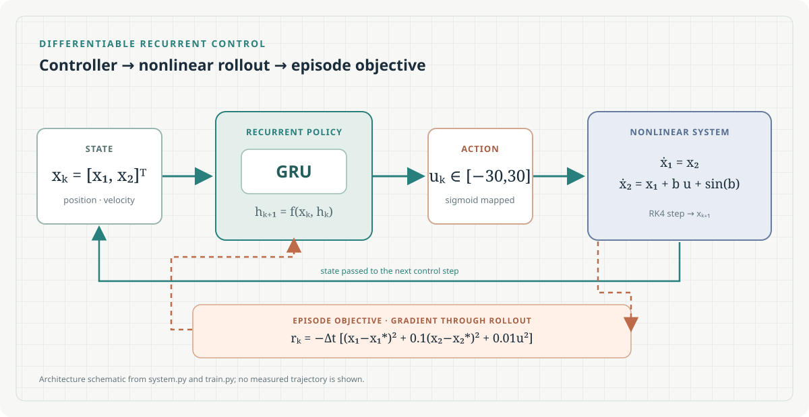

# MA-APG

A PyTorch implementation of a recurrent controller for a nonlinear two-state control system. The controller is trained by differentiating through RK4 simulated episodes.

[Project homepage](https://paoshou-china.github.io/MA-APG/) · [Source repository](https://github.com/PaoShou-China/MA-APG)



## Model

The state is (x=[x_1,x_2]^T), with dynamics

```text
ẋ₁ = x₂
ẋ₂ = x₁ + b u + sin(b)
```

Here (u) is the scalar action and (b) is sampled per simulated environment. Each integration step uses fourth-order Runge–Kutta (RK4).

The per-step reward penalizes the next state and action:

```text
rₖ = −Δt [x₁,ₖ₊₁² + 0.1 x₂,ₖ₊₁² + 0.01 uₖ²]
```

The target is ([0,0]^T). At the end of an episode, the simulator adds a terminal state penalty with a factor of 10. Training minimizes the negative mean episode reward.

## Controller and training

`controller.py` defines the shared two-layer GRU controller with 64 hidden units per layer; `train.py` imports it for training, and `evaluate.py` uses the same implementation. The recurrent linear maps use spectral normalization. A sigmoid maps the output into the configured action range ([-30,30]).

Current source defaults in `TrainingConfig`:

- Time step: 0.02
- Parallel environments per episode: 2,000
- Episodes: 500
- Integration steps per episode: 15
- Sampled system parameter: (b in [0.1,10])
- Optimizer: Adam, learning rate 0.001

Training applies the configured seed (42 by default) to Python, NumPy, and PyTorch, differentiates the accumulated reward through the simulator rollout, and clips the controller gradient norm to 5.

## Installation

Use Python 3.8 or newer. Install the PyTorch build appropriate for your CPU or CUDA environment; the repository does not pin dependency versions.

```bash
git clone https://github.com/PaoShou-China/MA-APG.git
cd MA-APG
python -m venv .venv
source .venv/bin/activate
# Windows PowerShell: .venv\Scripts\Activate.ps1
python -m pip install --upgrade pip
python -m pip install numpy scipy
python -m pip install torch
```

## Quick start

Run from the repository root:

```bash
python train.py
python evaluate.py
```

Training creates `log/training_metrics.csv` and `log/full_trained_controller.pth`. Evaluation expects that checkpoint and writes `log/full_trained_controller_results.csv`. Run training before evaluation if the checkpoint is absent.

## Evaluation setup

`evaluate.py` runs 500-step rollouts. Its fixed cases use six configured initial states and (b=0.1,1,10); it also samples 50 parameter cases over the configured interval ([0.1,10]) for robustness plots. Evaluation settings are source-configured in `EvaluationConfig`; there is no command-line interface.

## Repository map

| File | Purpose |
| --- | --- |
| `system.py` | Nonlinear dynamics, RK4 integration, reward, initial-state sampling, and batched evaluation. |
| `controller.py` | Shared GRU cell and controller implementation used by training and evaluation. |
| `train.py` | Training defaults, optimization loop, and checkpoint writing. |
| `evaluate.py` | Fixed-scenario and parameter-sampling evaluation. |
| `index.html` | Static project homepage. |
| `assets/hero.svg` | Method schematic derived from the source implementation. |

## Reproduction notes

Training and evaluation apply their configured seed (42 by default) to Python, NumPy, and PyTorch. For reproducible experiments, record the source revision, dependency versions, device, and configuration. GPU results may vary across devices and library versions. GPU results may vary across devices and library versions. No verified dependency lock or cross-platform test matrix is included.

## Dependencies and license

Install NumPy, SciPy, and PyTorch as described above. See [requirements.txt](requirements.txt) for the unpinned dependency list and [LICENSE](LICENSE) for license terms.
